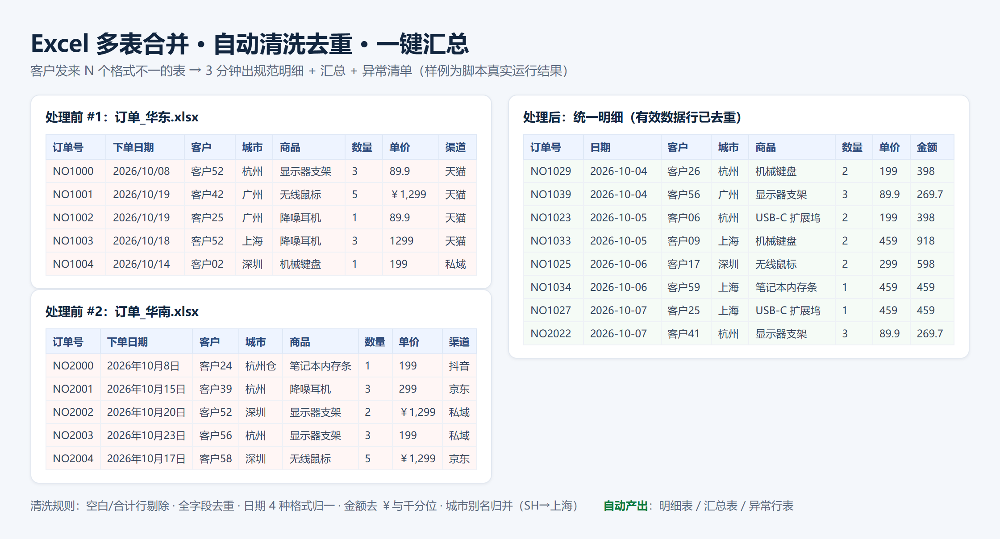

# 自动化脚本 / 数据处理 ｜ 明码标价 · 先看结果再付款

把重复劳动交给脚本。**Excel 批处理、网页数据采集、报表自动化、文件批量重命名/转换**，按件计价，交付源码。



## 一、能做什么（真实已跑通的样例在本仓库）

| 类别 | 典型需求 | 起价 | 交付周期 |
|---|---|---|---|
| Excel / CSV 处理 | 多表合并、去重清洗、分组汇总、格式统一、批量拆分、脏数据抢救 | ¥30 起 | 24 小时内 |
| 数据采集 | 公开网页/榜单/商品页结构化导出为 Excel（合规范围，不碰登录态与隐私数据） | ¥60 | 1–2 天 |
| 报表自动化 | 定时抓数 + 自动生成日报/周报 Excel 或图表 | ¥120 | 2–3 天 |
| 文件批处理 | 批量重命名、图片压缩/加水印、PDF 拆分合并、格式互转 | ¥20 | 12 小时内 |
| 小工具定制 | 按你的流程写一个双击就能用的脚本（含使用说明） | ¥50 起 | 1–2 天 |

- **加急**：+50%，12 小时内交付。
- **改动**：验收前免费改到满意；交付后 7 天内小调整免费。
- **退款**：跑不出承诺的结果，全额退。

## 二、怎么下单（3 步）

1. 在 **Issues** 里发一条，写清：你要处理的文件长什么样、想要的结果长什么样（脱敏样例最好）。
2. 我回复报价与工期，确认后开始。
3. 交付：可运行脚本 + 使用说明 + 一次真实数据的运行结果截图。**先看结果，满意再付款。**

## 三、样例说明

`excel_batch/` 是一个完整可运行样例：把「订单_华东 / 订单_华南 / 订单_补录」三张表合并、去重、清洗金额与日期、按区域汇总，一键输出 `合并清洗结果.xlsx` 与预览页。

```
python excel_batch/seed_and_clean.py
```

## 四、工具箱（本仓库直接可用的东西）

`xls_clean.py` —— 通用表格清洗命令行工具，单文件、无联网、无混淆：

```bash
python xls_clean.py report 你的表.xlsx          # 先诊断：空列/重复主键/脏字符/待脱敏列
python xls_clean.py clean 原始表.xlsx -o 清洗后.xlsx   --ops trim,norm-cols,empty,dedupe,to-date,to-number   --date-cols 下单日期 --number-cols 金额 --dedupe-key 手机号
python xls_clean.py merge 表1.xlsx 表2.xlsx -o 总表.xlsx
python xls_clean.py split 总表.xlsx --by 区域 --outdir 拆分结果
```

`python demo.py` 会造一份典型脏数据（空格/零宽字符/4 种日期写法/¥千分位/重复单/明文手机号），跑完打印前后对比与处理明细——这是交付时给你的"改了什么"凭证，不用你信我口头说的。

## 五、边界

- 只做合规需求：不代做毕设/论文、不采集需登录或涉隐私的数据、不写抢购/刷量类脚本。
- 不接触你的账号密码；如需登录态数据，由你本地运行脚本。

---
需要报价？直接在 [Issues](../../issues) 留需求，我看到会回。
